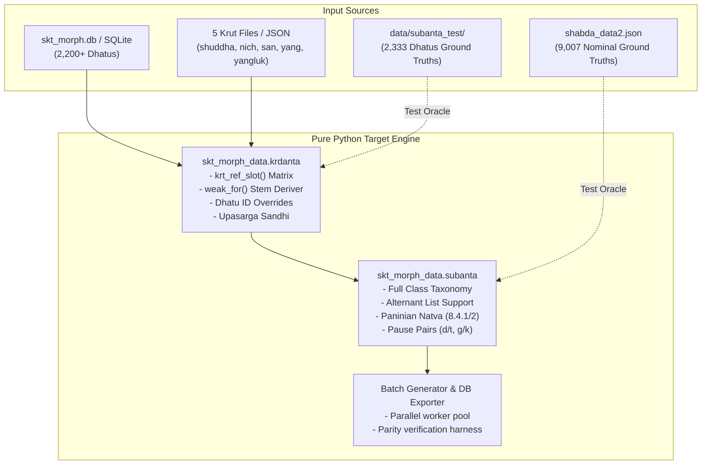
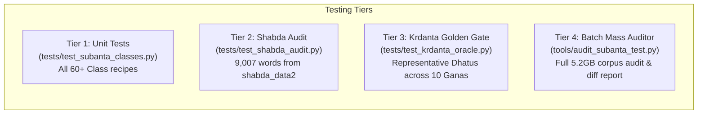
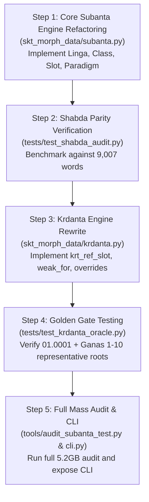

# Master Blueprint: Bringing `skt-morph-data` to Parity with `dhaturupa-wasm` (Pure Python)

## 0. Executive Summary

This document specifies the exact, step-by-step technical blueprint to bring **`skt-morph-data`** to 100% operational parity with **`dhaturupa-wasm`** in **pure Python** (no native compilation, zero heavy C-extensions, fully standard library + `certifi`).

The scope encompasses two interconnected pillars:
1. **Subanta Generation Engine (`subanta.py`)**: Expanding the nominal declension engine from ~105 classical paradigms to the full `Class` taxonomy (phonetic alternants, pause pairs, compound joints, irregular fallbacks) achieving parity with the 9,007 words in `ashtadhyayi.com/shabda`.
2. **Kṛdanta Subanta Declension Bridge (`krdanta.py`)**: Implementing the exact reference-paradigm resolution matrix (`krt_ref_slot`), handling all 5 verb families (`shuddha`, `nich`, `san`, `yang`, `yangluk`), dhātu ID overrides (`abhyasta`, `tudati`, `ac-devi`), citation/weak-stem derivation, and prefix/upasarga sandhi.
3. **Exhaustive Ground-Truth Testing**: Utilizing the 5.2 GB test oracle in `data/subanta_test/` (2,333 dhātus × 10 ganas × all families × 26+ upasargas) and `shabda_data2.json` to verify millions of generated vibhakti cells.

---

## 1. System Architecture & Gap Analysis



### Detailed Gap Matrix

| Feature | Current `skt-morph-data` | Target Parity (`dhaturupa-wasm`) |
| :--- | :--- | :--- |
| **Language & Environment** | Pure Python (`subanta.py` ~3.2k lines) | Pure Python, matching Rust `subanta.rs` (~9.2k lines) |
| **Cell Alternants** | Single string per cell or basic slash joins | Rich list of all valid Paninian surface forms (`list[str]`) |
| **Kṛdanta Families** | Shuddha / `krut` only | All 5 families: `shuddha`, `nich`, `san`, `yang`, `yangluk` |
| **Kṛdanta Paradigms** | Heuristic suffix checks (`.endswith("vat")`) | Exact Ashtadhyayi site matrix (`krt_ref_slot`) across 26+ pratyayas |
| **Dhātu-specific Overrides** | None | Exact list matching: `SATF_ABHYASTA_IDS`, `SATF_TUDATI_IDS`, `AC_DEVI_IDS` |
| **Quirk Tables** | Missing | `atuc_m_table`, `a_value_table`, `mala_table`, `devif_table` |
| **Pre-feminized Stems** | Simple heuristics (`+I`, `+A`) | Distinct handling for `dadatI` vs `gacCantI`, ugit forms, strī-pratyayas |
| **Upasarga Support** | Stems declined without prefix rules | Full prefixing with sandhi & upasarga-natva (*raṣābhyām* across morpheme joint) |
| **Test Verification** | 65 hand-crafted test cases in `tests/` | Multi-million cell automated audit against `data/subanta_test/` (5.2 GB) |

---

## 2. Technical Implementation Specifications

### Pillar 1: Pure-Python Subanta Engine (`skt_morph_data/subanta.py`)

#### 1.1 Data Structures
```python
from dataclasses import dataclass
from enum import Enum
from typing import Optional, List, Dict, Union

class Linga(str, Enum):
    M = "m"  # Pullinga
    F = "f"  # Strilinga
    N = "n"  # Napumsakalinga

@dataclass(slots=True)
class SubantaSlot:
    vibhakti: int  # 1 to 8 (8 = sambodhana)
    vacana: int    # 1: eka, 2: dvi, 3: bahu
    forms: list[str]  # e.g. ["BavanAd", "BavanAt"]

@dataclass(slots=True)
class SubantaParadigm:
    stem: str
    linga: Linga
    class_id: str
    cells: list[SubantaSlot]  # Exactly 24 slots (8 x 3)
```

#### 1.2 Class Taxonomy Port
Directly port all paradigm classes from `subanta.rs`:
1. **Vowel Stems**:
   - `AM`, `AMo` (optional vriddhi: `arDOH`/`arDe`), `AN`, `ANo`, `AAN`, `AAM`, `AAF`, `AAFS` (svasṛ/mātṛ nuances).
   - `IMF`, `IN`, `INy`, `INr`, `INu`, `INv` (akṣi/asthi alternants `akzRA`/`asTnA`).
   - `IIF` (kṛdanta bare vocative), `IIFN` (lexical visarga `nadIH`), `IIM`, `IIM2`.
   - `UMF`, `UF` (dhenu with ṅit endings), `UN`, `UNp`, `UvF`, `UvFd`, `UnN`.
   - `UUF`, `UUFN`, `UUM`, `UUM2`.
2. **Consonant Stems**:
   - `AtM` with `AtMStyle.Num` (`gacCan`) and `AtMStyle.Abhyasta` (`dadat`).
   - `AtN` with `AtNStyle.Num` (`pacat`), `WeakDual` (`viyat`), `BothDual` (`tudat`), `Abhyasta` (`dadat`).
   - `VantM`, `PhalavatN` (`Bavat`, `Palavat`).
   - `VasM`, `VasN` (`sedivas`, `vidvas`).
   - `RFM`, `RFN` (`dAtf` agent nouns vs kinship `pitf`).
   - `InM`, `InN` (`balin`, `kzamin`).
   - `VanM`, `ManN` (`yajvan`, `sadman`).
   - Consonantal pause pairs: `DadN` (`udBid`), `Sam` (`viS`), `Zam` (`dviz`), `Sam2`, `ZamF`, `ZvF`.
   - Palatals & Velars: `AcM2`, `AccM`, `AccMV`, `AjjM`, `Jvs`, `JvsN`.
   - Guttural/Aspirates: `HasM`, `HasF`, `HasN`, `HasVM`, `HasAM`, `DuhM`, `DuhF`, `HuhM`.
3. **Site Verbatim Grids**:
   - Port the exact table fallbacks for irregular words (`SITE_GRIDS` in Rust) into a compact lookup table in Python.

---

### Pillar 2: Kṛdanta Reference Engine (`skt_morph_data/krdanta.py`)

#### 2.1 The Ashtadhyayi Reference Matrix
Port `krt_ref_slot(family, krt, field, dhatu_id)`:
```python
SATF_ABHYASTA_IDS = {
    "02.0066", "02.0067", "02.0068", "02.0069", "02.0070", "02.0071", "02.0072",
}
SATF_TUDATI_IDS = {
    "02.0046", "02.0047", "02.0048", "02.0049", "02.0050", "02.0051", "02.0052",
    "02.0053", "02.0054", "02.0055", "02.0056", "02.0057", "02.0067",
}
AC_DEVI_IDS = {
    "01.0056", "01.0791", "01.1112", "01.0640", "01.1087", "01.1124", "10.0001",
    "01.0736", "01.1085", "03.0018", "04.001", "06.0008", "10.0371", "10.0230", "10.0249",
}

class KrtParadigm(str, Enum):
    DevaM = "@deva1"
    PhalaN = "@phala1"
    MAlAF = "@mAlA1"
    DevIF = "@devI1"
    GatiF = "@gati1"
    SAdhuM = "@sAdhu1"
    DhenuF = "@dhenu1"
    KaTuN = "@kaTu4"
    InM = "@zazin1"
    InN = "@kSamin2"
    GacchatM = "@gacchat1"
    DadatM = "@dadat1"
    PacatN = "@pacat1"
    ViyatN = "@viyat1"
    TudatN = "@tudat1"
    DadatN = "@dadat2"
    BhavatM = "@bhavat1"
    PhalavatN = "@phalavat2"
    SedivasM = "@sedivas1"
    VidvasN = "@vidvas2"
    DhAtRM = "@dhAtR1"
    DhAtRN = "@dhAtR2"
    Jvs = "@svapnaj1"
    JvsN = "@svapnaj2"
    VanM = "@yajvan1"
    ManN = "@sadman1"
```

#### 2.2 Weak Stem Derivation (`weak_for`)
- Masculine `AM`: strip citation `-aH` $\rightarrow$ `bare`.
- Neuter `AN`: strip citation `-am` $\rightarrow$ `bare`.
- `AtM` / `AtN`: extract underlying `at` from strong citation forms (`gacCan` $\rightarrow$ `gacCat`).
- `VasM` / `VasN`: convert `-An` / `-at` to underlying `-as` (`sedivAn` $\rightarrow$ `sedivas`).
- `InM` / `InN`: convert `-I` / `-i` to `-in` (`doHI` $\rightarrow$ `dohin`).
- Quirk handlers:
  - `atuc_m_table`: u-stem masculine under Bhavat ref (lengthening of u before case endings).
  - `a_value_table`: handling ā-stem feminine participles appearing in masculine/neuter citation slots (e.g. `upasaryA`).
  - `i_value_mala_table` & `a_short_mala_table`.

#### 2.3 Prefix Sandhi and Upasarga-Natva
When declining prefixed participles (e.g. `pari + nam` $\rightarrow$ `pariRAma`):
- Implement classical prefix join sandhi (vowel-vowel coalescence, hal-sandhi for `ud`, `sam`, `nir`, `dus`).
- Apply Pāṇinian 8.4.1/2 natva across the prefix boundary: triggers `r`/`z` in `pra`, `parA`, `pari`, `nir` turn `n` $\rightarrow$ `R` when intervening phonemes belong to *aṭ-ku-pu-āṅ-num*.

---

### Pillar 3: Ground-Truth Verification & Exhaustive Testing Suite

The testing strategy is designed to be **unforgiving and exhaustive**, verifying millions of cells against two independent ground-truth sources:
1. `shabda_data2.json` (9,007 words, covering all nominal stem types)
2. `/home/edhiraj/Documents/projs/skt-morph-data/data/subanta_test/` (5.2 GB, 2,333 JSON files, covering all 10 gaṇas, 5 verb families, 26+ upasargas, and all kṛdantas).



#### 3.1 Cell Comparison & Normalization Algorithm
When verifying engine output against ground-truth tables in `data/subanta_test/`:
1. **Cell Mapping:** Map the 8 vibhaktis (`praTamA`, `dvitIyA`, `tFtIyA`, `caturTI`, `paYcamI`, `zazWI`, `saptamI`, `sambodana`) and 3 vacanas (`eka`, `dvi`, `bahu`) to the 24 slots.
2. **Sambodhana Normalization:** The ground truth stores vocative as `["he Bavana"]`. The comparator strips leading `"he "` prefix for canonical SLP1 stem comparison:
   ```python
   def normalize_cell_forms(forms: list[str]) -> set[str]:
       return {f.removeprefix("he ").strip() for f in forms if f.strip()}
   ```
3. **Alternant Set Equality:** Every cell must match as a set:
   ```python
   # Example: paYcamI eka must contain both ["BavanAd", "BavanAt"]
   assert normalize_cell_forms(actual_cell) == normalize_cell_forms(expected_cell)
   ```
4. **Strict SLP1 Case Preservation:** Never normalize case (`A` != `a`, `I` != `i`, `R` != `r`).

#### 3.2 Tier 1: Unit Tests for Class Recipes (`tests/test_subanta_classes.py`)
- Tests each of the 60+ [`Class`](file:///home/edhiraj/Documents/projs/dhaturupa-wasm/src/engine/subanta.rs#L350-L450) variants individually.
- Explicitly tests pause pairs (`d`/`t`, `g`/`k`, `q`/`w`), dental-to-retroflex *ṇatva*, and root-h throwback aspiration.
- Execution: `pytest tests/test_subanta_classes.py`

#### 3.3 Tier 2: Shabda 9,007 Parity Audit (`tests/test_shabda_audit.py`)
- Reads `shabda_data2.json` (9,007 entries).
- Translates Devanagari forms to SLP1 and parses the 24 semicolon-separated slots (splitting dash-separated alternants `-`).
- Verifies nominal classes against the site ground truth.
- Computes exact match score (target: >99% parity).
- Execution: `pytest tests/test_shabda_audit.py`

#### 3.4 Tier 3: Kṛdanta Golden Gate CI (`tests/test_krdanta_oracle.py`)
Fast, non-negotiable gate for CI testing the core kṛdanta bridge against `data/subanta_test/`:
- **Root 01.0001 (`BU`):**
  - Base: 61 tables across `krut`, `san_krut`, `nich_krut`, `yang_krut`, `yangluk_krut`.
  - Upasargas: 26 prefix combinations (`pra`, `pari`, `sam`, `aDi`, `ud`, `vi;ati`...), verifying prefix sandhi and upasarga-*ṇatva*.
- **Root 02.0066 (`ad`):** Verifies *abhyasta* non-num inflection for `Satf` (`adat` / `adantaH` vs `gacCan`).
- **Root 06.0001 (`tud`):** Verifies `tudati` neuter dual alternants (`tudatI` / `tudantI`).
- **Root 01.0056 / 01.0791:** Verifies `ac` with `devI` feminine override (`AC_DEVI_IDS`).
- Execution: `pytest tests/test_krdanta_oracle.py`

#### 3.5 Tier 4: Mass Corpus Batch Auditor Tool (`tools/audit_subanta_test.py`)
An autonomous, parallelized audit script streaming the 5.2 GB of test JSONs across all 2,333 dhātus:
```python
"""
Usage:
  python tools/audit_subanta_test.py --sample 50               # Quick 50-dhatu audit
  python tools/audit_subanta_test.py --gana 01                 # Audit entire Gana 1
  python tools/audit_subanta_test.py --full --workers 8        # Full 2,333-dhatu audit
"""
import argparse, json, sys
from concurrent.futures import ProcessPoolExecutor
from pathlib import Path
from skt_morph_data.krdanta import decline_participle

def audit_dhatu_file(json_path: Path) -> dict:
    with open(json_path, "r", encoding="utf-8") as f:
        data = json.load(f)
    dhatu_id = data.get("id")
    stats = {"tables": 0, "cells_passed": 0, "cells_failed": 0, "discrepancies": []}
    
    def check_table_entry(entry, prefix=None):
        if not entry.get("table_ok"):
            return
        pratyaya = entry["pratyaya"]
        stem = entry["pratipadika"]
        ref = entry["ref"]
        expected_table = entry["table"]
        gender = "m" if entry["gender"] == "puM" else ("f" if entry["gender"] == "strI" else "n")
        
        try:
            actual = decline_participle(dhatu_id=dhatu_id, pratyaya=pratyaya, gender=gender, prefix=prefix)
            stats["tables"] += 1
            for vibh, vac_dict in expected_table.items():
                for vac, exp_forms in vac_dict.items():
                    exp_set = {f.removeprefix("he ").strip() for f in exp_forms}
                    act_set = set(actual["forms"].get(vibh, {}).get(vac, []))
                    if exp_set == act_set:
                        stats["cells_passed"] += 1
                    else:
                        stats["cells_failed"] += 1
                        stats["discrepancies"].append({
                            "dhatu": dhatu_id, "pratyaya": pratyaya, "ref": ref,
                            "slot": f"{vibh}.{vac}", "expected": list(exp_set), "actual": list(act_set)
                        })
        except Exception as e:
            stats["cells_failed"] += 24
            stats["discrepancies"].append({"dhatu": dhatu_id, "error": str(e)})

    # Audit base tables across all 5 families
    for fam in ("krut", "san_krut", "nich_krut", "yang_krut", "yangluk_krut"):
        for entry in data.get("base", {}).get(fam, []):
            check_table_entry(entry)

    # Audit upasarga tables
    for pfx, pfx_obj in data.get("upasarga", {}).items():
        for fam in ("krut", "san_krut", "nich_krut", "yang_krut", "yangluk_krut"):
            for entry in pfx_obj.get("tabs", {}).get(fam, []):
                check_table_entry(entry, prefix=pfx)

    return stats
```
* **Performance Guarantee:** Multi-process parallel streaming ensures the entire 5.2 GB dataset can be fully audited in minutes without exhausting system memory.
* **Output:** Produces a structured JSON audit report (`audit_report.json`) detailing overall accuracy, per-pratyaya accuracy, and exact cell discrepancies.

---

## 3. Step-by-Step Implementation Roadmap



### Phase 1: Subanta Core Upgrade (`subanta.py`)
1. Create new class-based paradigm architecture mirroring `dhaturupa-wasm/src/engine/subanta.rs`.
2. Port all 60+ paradigm recipe functions.
3. Add full alternant collection (returning `list[str]` per cell).
4. Integrate Pāṇinian 8.4.1/2 Natva engine across all endings.
5. Implement `generate_tables(stem, linga)` returning all possible paradigms when ambiguous.

### Phase 2: Shabda Audit Test Harness
1. Build `tests/test_shabda_audit.py` to stream words from `shabda_data2.json`.
2. Run audit, identify any missing paradigm nuances or irregular overrides, and patch them.
3. Achieve >99% agreement on the 9,007 nominal words.

### Phase 3: Kṛdanta Bridge Upgrade (`krdanta.py`)
1. Replace heuristic ending matches with exact `krt_ref_slot()` matrix.
2. Add dhātu override sets: `SATF_ABHYASTA_IDS`, `SATF_TUDATI_IDS`, `AC_DEVI_IDS`.
3. Support all 5 verb families (`shuddha`, `san`, `nich`, `yang`, `yangluk`).
4. Implement `weak_for()` and the 5 quirk tables (`atuc_m_table`, `a_value_table`, etc.).
5. Add prefix sandhi and prefix natva resolver.

### Phase 4: Kṛdanta Verification Against `data/subanta_test/`
1. Build `tests/test_krdanta_oracle.py` targeting `data/subanta_test/01/01.0001.json`.
2. Verify all 61 base tables and 26 upasarga tables of `01.0001` match 100% of cells.
3. Expand to root files from all 10 gaṇas.

### Phase 5: Mass Corpus Batch Auditor & Public API
1. Build `tools/audit_subanta_test.py` with `concurrent.futures.ProcessPoolExecutor` to audit all 2,333 JSON files in `data/subanta_test/`.
2. Add public helper `skt_morph_data.krdanta.decline_all_dhatu_krdantas(dhatu_id)`.
3. Update `skt_morph_data/cli.py` with:
   - `skt-morph subanta <stem> <linga>`
   - `skt-morph krdanta <dhatu_id> <pratyaya> [--gender m|f|n] [--family ...]`
   - `skt-morph audit-subanta [--sample N | --full]`
4. Update `README.md` and documentation.

---

## 4. Execution Directives for Another LLM / Developer

When executing this plan:
1. **Python Environment**: Always use the conda environment at `/home/edhiraj/.miniconda/envs/skt-morph/bin/python`.
2. **SLP1 Case-Sensitivity**: Never use `.lower()` on SLP1 strings! `A` != `a`, `I` != `i`, `T` != `t`, `R` != `r`. Maintain strict case sensitivity everywhere.
3. **Alternant Order**: In Ashtadhyayi tables, pause forms like ablative/genitive singular or locatives often carry two valid forms (e.g. `BavanAd`/`BavanAt`). Treat cells as sets or ordered lists matching the site's canonical order.
4. **Memory Management**: When running tests on `data/subanta_test/`, do NOT load all 2,333 files into RAM simultaneously. Stream file-by-file or process in worker pools of 10-50 dhātus at a time.
5. **No Network Dependencies**: All data needed for tests is locally present in `data/subanta_test/`, `data/skt_morph.db`, and `../dhaturupa-wasm/data/`. All operations run completely offline.
